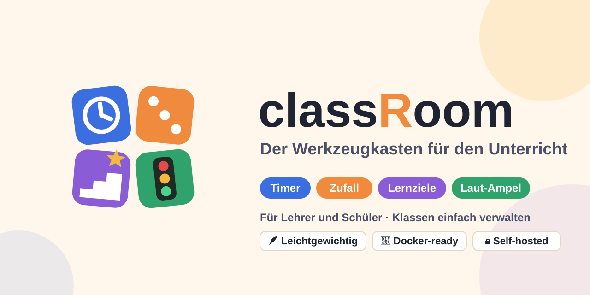

<p align="center"></p>

# classRoom

Ein Werkzeugkasten für Lehrerinnen und Lehrer: verschiedene kleine Tools, die sich direkt während des Unterrichts nutzen lassen – schnell erreichbar, ohne Einarbeitung und gut lesbar am Beamer oder Smartboard.

## Funktionen

- **Kopfzeile** (in allen Modi)
  - Zahnrad-Menü oben links, auf Wunsch ausgeblendet (erscheint beim Darüberfahren)
  - Balken *abgelaufene Zeit* seit Beginn der Stunde (mit Sanduhr)
  - Balken *Klassenraum · zurück um HH:MM* – wird orange kurz vor der Rückkehr und rot, wenn die Zeit um ist
  - Große analoge Uhr mit Wochentag und Datum (dd/mm/yyyy) oben rechts
- **Auftrag** (Startseite) – Box mit Titel, Text, Links und Bildern für den aktuellen Auftrag. Bilder stehen links als Vorschau (Klick vergrößert), der Auftragstext rechts daneben. Lehrkräfte bearbeiten ihn direkt im Editor mit Werkzeugleiste: fett, kursiv, unterstrichen, Aufzählung, nummerierte Liste, Textfarbe, Link, Bild (auch per Strg+V oder Hineinziehen). Das HTML wird beim Speichern serverseitig bereinigt.
- **Stundenziele** – erreichbar über den Button unter dem Auftrag. Kacheln wie im Selbstlern-Modus, aber mit eigenen Zielen für die aktuelle Stunde; „Neue Stunde“ leert sie.
- **Test-Modus** (Menü) – Vollbild-taugliche Anzeige für Prüfungen: große Uhrzeit, Balken „Vergangen“ und „Verbleibend“ (orange kurz vor Schluss, rot wenn die Zeit um ist). Start per Dauer oder Endzeit, Verlängern um 5/10 Minuten. Läuft serverseitig weiter, auch nach Neuladen.
- **Schüler verwalten** – Vorname und Nachname; der Benutzername wird vorgeschlagen (3 Buchstaben Vorname + 2 Nachname, z. B. Anna Muster → `annmu`) und ist änderbar, das Passwort wird automatisch erzeugt
- **Selbstlern-Modus** – eine Kachel pro Schüler mit eigenen Zielen zum Abhaken, Fortschrittsbalken; erledigte Ziele werden grün, die Kachel ist ganz grün, wenn alles erledigt ist. Aktualisiert sich alle 5 Sekunden.
- **Login** mit zwei Rollen:
  - *Lehrkräfte* sehen alles inkl. Menü; weitere Lehrkräfte unter „Lehrer verwalten“
  - *Schüler* sehen Auftrag, Stundenziele und Selbstlern-Modus (ohne Menü), sehen alle Kacheln, bearbeiten aber nur ihre eigene

### Zugänge

- Das erste Lehrerkonto kommt aus der `.env` (`TEACHER_USERNAME` / `TEACHER_PASSWORD`). Bei jedem Start wird sein Passwort auf den `.env`-Wert gesetzt – so kommt man nach einem vergessenen Passwort wieder hinein.
- Schülerzugänge entstehen beim Erfassen. Das Passwort wird **nur einmal** angezeigt; „Neues Passwort“ erzeugt ein neues und meldet den Schüler überall ab.
- Nach 5 falschen Passwörtern ist ein Benutzername für 5 Minuten gesperrt.

### Geplant

- Timer & Stoppuhr, Zufallsauswahl, Gruppen bilden, Lautstärke-Ampel

## Technik

SvelteKit (Svelte 5) · SQLite (`better-sqlite3`) · Docker Compose

## Konfiguration

Alle Einstellungen kommen aus einer `.env`-Datei:

```bash
cp .env.example .env
```

| Variable | Bedeutung | Standard |
|---|---|---|
| `PORT` | Port der App | `3000` |
| `DATABASE_PATH` | Pfad der SQLite-Datei (nur lokal; im Container fest `/app/data`) | `data/classroom.db` |
| `TEACHER_USERNAME` | Benutzername des Lehrerkontos aus der `.env` | `lehrer` |
| `TEACHER_PASSWORD` | Passwort dazu (mind. 8 Zeichen) – **unbedingt setzen** | leer |
| `SESSION_HOURS` | Wie lange eine Anmeldung gültig bleibt | `12` |
| `DEFAULT_ROOM_NAME` | Name des Klassenraums | `Klassenzimmer` |
| `DEFAULT_START_TIME` | Beginn der Stunde (`HH:MM`) | leer |
| `DEFAULT_RETURN_TIME` | Rückkehr ins Hauptschulzimmer (`HH:MM`) | leer |
| `WARN_MINUTES` | Ab wie vielen Minuten vor der Rückkehr der Balken orange wird | `5` |
| `DEFAULT_THEME` | Standard-Darstellung: `system`, `light` oder `dark` (umschaltbar im Menü, pro Gerät gespeichert) | `system` |
| `GOALS_COLLAPSED` | Ziel-Kacheln standardmäßig eingeklappt (nur Name + Fortschritt) | `true` |
| `UPLOAD_MAX_MB` | Maximale Bildgröße im Auftrag (PNG, JPEG, GIF, WebP) | `5` |

Raumname, Beginn und Rückkehrzeit lassen sich im Menü kurzfristig überschreiben. Diese Werte werden in der Datenbank gespeichert; *Standard* im Menü setzt sie auf die Werte aus der `.env` zurück.

## Starten

### Mit Docker

```bash
docker compose up -d --build
```

Danach läuft die App unter <http://localhost:3000> (bzw. dem `PORT` aus der `.env`). Die Datenbank liegt im Docker-Volume `classroom-data` und bleibt bei Updates erhalten.

Backup der Datenbank:

```bash
docker compose cp classroom:/app/data/classroom.db ./backup.db
```

### Lokal mit Node.js (ab Version 22)

```bash
npm install
npm run dev      # Entwicklung mit Hot-Reload
npm run build && npm start   # Produktionsbuild
```
