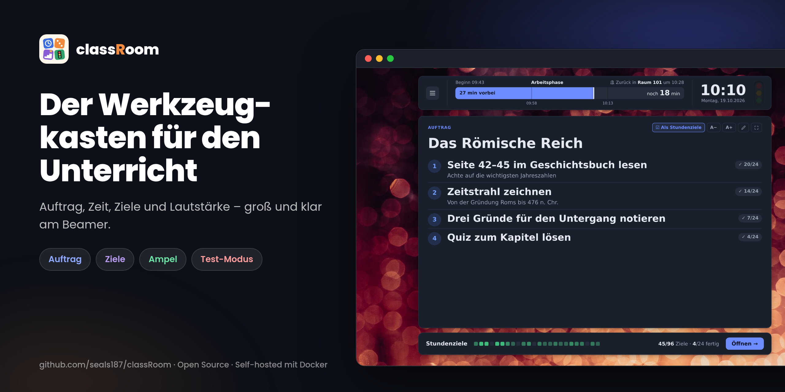
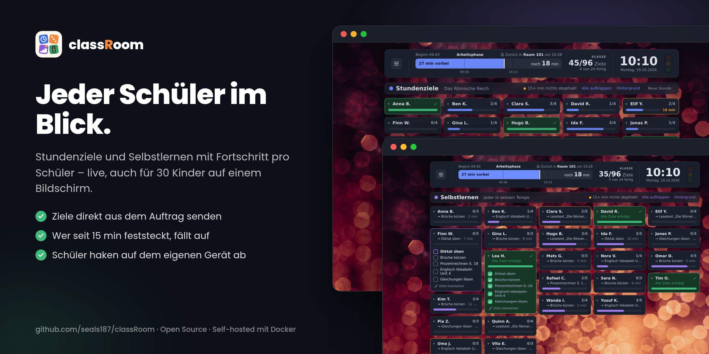
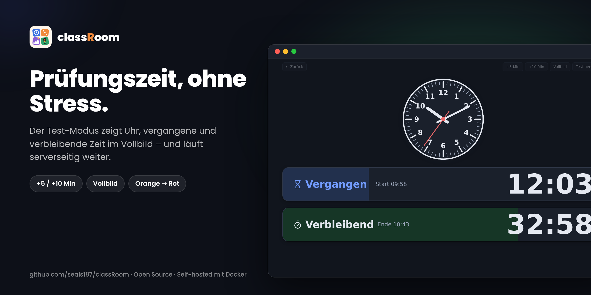
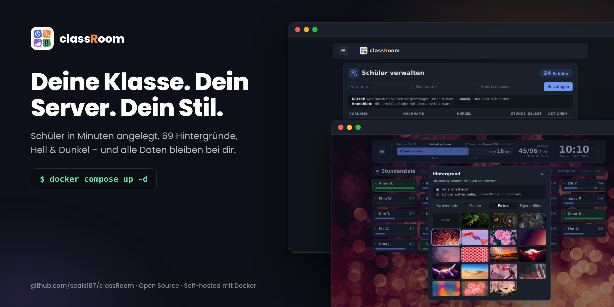

<p align="center"></p>

<p align="center">
  <a href="CHANGELOG.md"></a>
  <a href="LICENSE"></a>
  
  
</p>

**classRoom** ist ein Werkzeugkasten für Lehrerinnen und Lehrer: Auftrag, Zeit, Ziele und Lautstärke – groß und klar am Beamer, ohne Einarbeitung. Selbst gehostet mit Docker, alle Daten bleiben auf dem eigenen Server.

[Funktionen](#funktionen) · [Installation](#installation) · [Konfiguration](#konfiguration) · [Update, Daten & Backup](#update-daten--backup) · [Entwicklung](#entwicklung) · [Changelog](CHANGELOG.md)

## Funktionen

| | |
|---|---|
| 📋 **Auftrag** | Großer Titel, nummerierte Schritte, Bilder und Links; Editor mit Formatierung. Schrift per **A− / A+** (bis 250 %) und Bilder in feinen Stufen vergrößern, Vollbild. Schritte als **Stunden- oder Selbstlern-Ziele** an alle, eine **Gruppe** oder einzelne Schüler senden (mit Rückgängig); Gruppen mit Name und Farbe bleiben gespeichert – danach zeigt jeder Schritt, wie viele ihn erledigt haben. Per **QR-Code teilen**: Handys öffnen den Auftrag ohne Anmeldung, nur zum Lesen – mit dem Zeitband der Stunde (Restzeit, Aufräumen, Losgehen). |
| ⏱️ **Kopfband** | Zeitbalken in vier Phasen (Arbeitsphase · Aufräumen · Jetzt zurück in Raum 101 · Sofort zurück in Raum 101!), rechts immer „Zurück in Raum 101 um 22:38“, mit Viertelstunden-Strichen, Digitaluhr. Ohne laufende Stunde zeigt der Balken **„▶ Stunde starten · 45 min · bis 18:18 · Zimmer 101“** und „Anpassen…“. Im Menü startet eine Karte die Stunde mit den Reitern **Zeit · Raum · Aufräumen**: Dauer (15/30/45/90 min) oder eigene Zeiten, Raum aus einer eigenen Liste (oder kein Raumwechsel), Aufräumen-Phase in Minuten. Der **Wochenplan** im Menü legt pro Wochentag beliebig viele Stunden mit Raum fest (z. B. Mo 12:00–13:00 · Werkraum); die nächste Stunde von heute steht dann im Startbalken. Gestartet wird immer per Klick, die geplante Dauer läuft ab dem Klick. |
| 🎯 **Stundenziele & Selbstlernen** | Eine Kachel pro Schüler, live aktualisiert, 20–30 Schüler ohne Scrollen. Jede Kachel zeigt das aktuelle Ziel und die Zeit seit dem letzten Abhaken – wer seit 15 min nichts abgehakt hat, wird gelb markiert. Schüler können **„Nur meine Kachel“** einschalten. |
| 🚦 **Lautstärke-Ampel** | Misst über das Mikrofon des Lehrer-Geräts – nur im Browser, kein Ton wird gespeichert oder übertragen. Schüler sehen die Farbe. |
| 📝 **Test-Modus** | Große Uhr, vergangene und verbleibende Zeit im Vollbild; läuft serverseitig weiter. |
| 🎨 **Hintergründe** | 25 Verläufe, 26 Muster, 18 Fotos oder eigene Bilder – für alle festgelegt oder von jedem Schüler selbst gewählt. Hell- und Dunkelmodus. |
| 👥 **Verwaltung** | **Klassen** mit Name und Farbe; Schüler einzeln, als eingefügte Liste (ein Name pro Zeile, Kürzel automatisch) oder aus einer anderen Klasse hinzufügen, Zugangsdaten als Kärtchen drucken. Ein Schüler kann in mehreren Klassen sein, eine Klasse mehrere Lehrkräfte haben (Häkchen-Tabelle Lehrkraft × Klasse). Schüler melden sich mit Kürzel oder „Vorname Nachname“ an. Jede Lehrkraft sieht nur ihre Klassen und hat ihren eigenen Auftrag, Ziele, Stunde und Wochenplan; einen Auftrag kann man an eine andere Lehrkraft kopieren oder übertragen. Der Admin kann sich per Knopf **als eine Lehrkraft oder ein Schüler anmelden** und sieht classRoom dann genau so (z. B. bei Problemen), „Zurück“ führt wieder zum eigenen Konto. |

<p align="center"></p>

<details>
<summary><b>Alle Details zu den Funktionen</b></summary>

**Auftrag (Startseite)**
- Eine nummerierte Liste erscheint als Schritte mit Zahl im Kreis – auch von Hand getippte Zeilen mit „- “ oder „1. “ am Anfang; **Umschalt+Enter** gibt einem Schritt eine graue Zusatzzeile.
- Bilder per Knopf, Strg+V oder Hineinziehen (irgendwo auf die Karte) – sie werden vor dem Hochladen verkleinert (höchstens 1920 px, einige hundert KB). Rechts als gleich zugeschnittene Vorschau, ein Klick zeigt das ganze Bild.
- Links stehen klein unten in der Karte. Das HTML wird beim Speichern serverseitig bereinigt.
- **Teilen per QR-Code** (Symbol neben A− / A+, standardmäßig aus): erzeugt einen zufälligen Link wie `/a/k7xq9mpzab`, gültig 1, 7 oder 30 Tage (Standard `SHARE_DAYS`). Der QR-Code erscheint groß in der Mitte (gut scannbar am Beamer), darunter der kurze Link zum Abtippen; auf Wunsch bleibt er klein unten rechts in der Karte. Die öffentliche Seite zeigt nur Titel, Text, Bilder und Links – keine Namen, Ziele, Fortschritte oder Klasse –, folgt Hell/Dunkel des Geräts und lädt alle 30 s neu. Oben steht das Zeitband der Stunde: Arbeitsphase mit Restzeit und „Zurück in … um …“, beim Aufräumen gelb-orange, zum Losgehen groß in Orange (auf dem Handy bildschirmfüllend, der Auftrag ist dann eingeklappt); ohne Stunde nur die Uhrzeit. „Neuer Link“ macht den alten ungültig, „Teilen beenden“ beendet ihn; Bilder gibt es nur mit gültigem Code. Ein gelöschter oder übertragener Auftrag ist nicht mehr geteilt. Im Menü unter **Anzeige → Geteilte Aufträge** sieht jede Lehrkraft ihre (der Admin alle) und kann verlängern oder beenden; dort steht auch, wenn die Adresse nur im Schulnetz erreichbar ist.
- Leiste **Stundenziele** darunter: ein Quadrat pro Schüler, je mehr erledigt, desto grüner – sind alle fertig: „🎉 Alle Ziele erledigt“.

**Stundenziele & Selbstlern-Modus**
- Klick auf eine Kachel klappt die Checkliste auf; nur die Kacheln darunter rücken nach. Lehrkräfte können alle auf-/einklappen.
- Beide Modi zeigen das aktuelle Ziel und die Zeit seit dem letzten Abhaken; lange Ziele werden gekürzt, die Zeit bleibt sichtbar.
- „Neue Stunde“ leert nur die Stundenziele; Selbstlern-Ziele bleiben.
- Schüler bearbeiten nur ihre eigene Kachel.

**Lautstärke-Ampel**
- Im Menü unter *Anzeige → Ampel*: Empfindlichkeit, Schwellen für Gelb und Rot, Live-Test.
- Browser erlauben das Mikrofon nur über **HTTPS oder `localhost`**.

**Zugänge**
- Das erste Lehrerkonto kommt aus der `.env` und ist **Admin**; sein Passwort wird bei jedem Start auf den `.env`-Wert gesetzt – so kommt man nach einem vergessenen Passwort wieder hinein.
- **Verwaltung** (Menü → *Klassen · Schüler · Lehrkräfte*): Klassen als Karten; eine Klasse öffnen zeigt ihre Schüler, rechts die Lehrkräfte und Sammel-Aktionen (Zugangsdaten drucken, Liste einfügen, alle Passwörter neu, archivieren). Archivierte Klassen verschwinden aus der Stunde und lassen sich wiederherstellen.
- **Admin** sieht alle Klassen und Schüler, legt Lehrkräfte an, benennt sie um und löscht sie, setzt ihre Passwörter, macht weitere Lehrkräfte zum Admin und weist Lehrkräfte den Klassen zu.
- **Lehrkräfte** sehen nur ihre Klassen und deren Schüler, legen eigene Klassen an und ändern unter *Mein Konto* nur ihr eigenes Passwort. Beim Starten einer Stunde wählen sie die Klasse (die zuletzt genutzte ist vorausgewählt); das Kopfband zeigt sie, Stundenziele und Kacheln gelten nur für diese Klasse, Selbstlern-Ziele über alle Klassen. Auftrag, Ziele, Stunde, Wochenplan, Räume, Gruppen, Test, Ampel und Hintergrund hat jede Lehrkraft für sich.
- **Schüler mit mehreren Lehrkräften** sehen die Klasse der Lehrkraft, die zuletzt eine Stunde gestartet hat, und können im Menü unter *Lehrkraft* wechseln.
- Schüler-Passwörter werden **nur einmal** angezeigt; „Neues Passwort“ meldet den Schüler überall ab.
- **Test-Schüler** (nur Admin): beim Hinzufügen oder Bearbeiten ankreuzen – zum Ausprobieren der Schüler-Sicht. Andere Lehrkräfte sehen ihn nirgends, auch nicht in gemeinsamen Klassen.
- Nach 5 falschen Passwörtern ist ein Benutzername 5 Minuten gesperrt.

**Allgemein**
- Für Smartphone und Tablet angepasst; eigene Dialoge im Stil der App.
- Geplant: Zufallsauswahl, Gruppen bilden.

</details>

<p align="center"> </p>

## Installation

Du brauchst nur **Docker mit Compose** – kein Node.js, kein Quellcode. Images gibt es für amd64 und arm64 (z. B. Raspberry Pi).

**1. Ordner anlegen** und zwei Dateien aus diesem Repo hineinkopieren: [`docker-compose.yml`](docker-compose.yml) und [`.env.example`](.env.example).

```bash
mkdir -p /opt/classroom && cd /opt/classroom
# docker-compose.yml und .env.example hierher kopieren
cp .env.example .env
```

**2. Passwort setzen** – in der `.env` mindestens das Lehrerkonto eintragen:

```ini
TEACHER_USERNAME=lehrer
TEACHER_PASSWORD=ein-sicheres-passwort
```

**3. Starten:**

```bash
docker compose pull
docker compose up -d
```

Fertig – classRoom läuft unter **http://localhost:3000** (bzw. `http://<server-ip>:3000`). Mit dem Lehrerkonto anmelden und unter *Menü → Klassen* die Schüler in „Meine Klasse“ eintragen oder weitere Klassen anlegen.

> [!TIP]
> Für die Lautstärke-Ampel braucht der Browser **HTTPS** (oder `localhost`). Im Schulnetz am einfachsten hinter einen Reverse Proxy wie Caddy oder Traefik stellen.

## Konfiguration
Alles steht in der `.env`; nach einer Änderung `docker compose up -d` ausführen. Raum, Zeiten, Aufräumen-Minuten, Ampel und Hintergrund sind die **Startwerte für jede Lehrkraft** – im Menü speichert jede Lehrkraft ihre eigenen Werte, die dann die `.env` überschreiben.
Alles steht in der `.env`; nach einer Änderung `docker compose up -d` ausführen. Raum, Zeiten, Aufräumen-Minuten, Ampel und Hintergrund lassen sich zusätzlich im Menü ändern – diese Werte überschreiben die `.env`.

| Variable | Wofür | Standard |
|---|---|---|
| `TEACHER_USERNAME` | Benutzername des ersten Lehrerkontos (immer Admin) | `lehrer` |
| `TEACHER_PASSWORD` | Passwort dazu – **muss gesetzt werden** (mind. 8 Zeichen) | – |
| `PORT` | Port, unter dem classRoom erreichbar ist | `3000` |
| `CLASSROOM_VERSION` | Image-Version, z. B. `0.4.4` | `latest` |

<details>
<summary><b>Weitere Einstellungen</b></summary>

| Variable | Wofür | Standard |
|---|---|---|
| `SESSION_HOURS` | Wie lange eine Anmeldung gültig bleibt (Stunden) | `12` |
| `DEFAULT_ROOM_CHANGE` | Nach der Stunde Raumwechsel: Balken zeigt „Zurück in Raum …“ statt nur „Ende“ | `true` |
| `DEFAULT_ROOM_NAME` | Raum, in den es danach zurückgeht | `Klassenzimmer` |
| `DEFAULT_START_TIME` / `DEFAULT_RETURN_TIME` | Beginn und Ende (`HH:MM`), leer = nicht gesetzt | – |
| `LESSON_DURATIONS` | Dauern in Minuten: die erste gilt für „Stunde starten“ im Kopfband (wenn heute nichts mehr im Wochenplan steht), alle erscheinen im Menü | `45,90` |
| `WARN_MINUTES` | Ab wie vielen Minuten vor Schluss „Aufräumen“ erscheint (auch Test-Modus) | `5` |
| `GO_MINUTES` | Ab wie vielen Minuten vor Schluss „Jetzt zurück in …“ erscheint | `3` |
| `DEFAULT_THEME` | `system`, `light` oder `dark` | `system` |
| `GOALS_COLLAPSED` | Ziel-Kacheln anfangs eingeklappt | `true` |
| `UPLOAD_MAX_MB` | Maximale Bildgröße nach dem Verkleinern | `5` |
| `PUBLIC_URL` | Adresse, unter der Handys classRoom erreichen (für QR-Code und Link beim Teilen), z. B. `http://192.168.1.20:3000` – leer = die Adresse im Browser | – |
| `SHARE_DAYS` | Wie lange ein geteilter Auftrag standardmäßig gültig ist (Tage, 1–365) | `7` |
| `NOISE_ENABLED` | Lautstärke-Ampel anzeigen | `true` |
| `NOISE_SENSITIVITY` | Empfindlichkeit des Mikrofons, 1–10 | `5` |
| `NOISE_YELLOW` / `NOISE_RED` | Pegel 0–100 für Gelb bzw. Rot | `50` / `75` |
| `DATABASE_PATH` | Nur ohne Docker: Pfad der SQLite-Datei | `data/classroom.db` |

</details>

## Update, Daten & Backup

**Aktualisieren** (auf `latest` bzw. `CLASSROOM_VERSION`):

```bash
docker compose pull && docker compose up -d
```

Daten bleiben dabei erhalten; neue Tabellen und Spalten werden beim Start automatisch ergänzt. Was sich geändert hat, steht im [CHANGELOG](CHANGELOG.md).

> [!NOTE]
> **Update auf 0.3.5 (mehrere Lehrkräfte):** Beim ersten Start gehen alle bestehenden Schüler, Ziele, Gruppen und der Auftrag an den Admin (das Konto aus der `.env`); die bisherigen Einstellungen bekommt jede Lehrkraft als Kopie. Die Umstellung lässt sich nicht rückgängig machen – vorher ein Backup anlegen (siehe unten).

### Wo liegen die Daten?

Nicht im Ordner mit der `docker-compose.yml`, sondern im **Docker-Volume** `classroom-data`, das Docker selbst verwaltet:

| Was | Wo |
|---|---|
| `docker-compose.yml`, `.env` | Im Installationsordner, z. B. `/opt/classroom` |
| Schüler, Ziele, Gruppen, Auftrag, Räume, Einstellungen, Logins | Eine SQLite-Datei `classroom.db` im Volume |
| Hochgeladene Bilder und Hintergründe | Ebenfalls in der Datenbank, nicht als einzelne Dateien |

Docker setzt den Ordnernamen vor den Volume-Namen – bei `/opt/classroom` heißt es `classroom_classroom-data`. Unter Linux liegt es meist unter `/var/lib/docker/volumes/classroom_classroom-data/_data/`. Name und Pfad zeigen:

```bash
docker volume ls
docker volume inspect classroom_classroom-data   # Pfad bei „Mountpoint“
```

> [!WARNING]
> `docker compose down -v` und `docker volume rm …` löschen das Volume und damit **alle Daten**. Ein normales `docker compose down` oder ein Update ist unbedenklich. Für einen Umzug auf einen anderen Server reicht es nicht, den Installationsordner zu kopieren – das Volume muss mit (siehe Backup).

### Backup & Wiederherstellen

```bash
# Nur die Datenbank sichern
docker compose cp classroom:/app/data/classroom.db ./backup.db

# Ganzes Volume als Archiv sichern (am besten bei gestopptem Container)
docker compose stop
docker run --rm -v classroom_classroom-data:/data -v "$PWD":/backup alpine tar czf /backup/classroom-backup.tgz -C /data .
docker compose up -d

# Archiv wiederherstellen – ersetzt alle aktuellen Daten!
docker compose stop
docker run --rm -v classroom_classroom-data:/data -v "$PWD":/backup alpine sh -c "rm -rf /data/* && tar xzf /backup/classroom-backup.tgz -C /data"
docker compose up -d
```

<details>
<summary><b>Daten lieber als normaler Ordner neben der <code>docker-compose.yml</code>?</b></summary>

In der `docker-compose.yml` statt des Volumes einen Ordner einbinden:

```yaml
    volumes:
      - ./data:/app/data
```

Bestehende Daten vorher einmal aus dem Volume nach `./data` kopieren – sonst startet classRoom leer.

</details>

## Entwicklung

<details>
<summary><b>Aus dem Quellcode bauen, lokal entwickeln, Release erstellen</b></summary>

**Technik:** SvelteKit (Svelte 5) · SQLite (`better-sqlite3`) · Docker

```bash
# Image lokal bauen – docker compose nimmt dann dieses statt des heruntergeladenen
docker build -t ghcr.io/seals187/classroom:latest .
docker compose up -d

# Ohne Docker (Node.js ab 22)
npm ci
npm run dev                  # Entwicklung mit Hot-Reload
npm run build && npm start   # Produktionsbuild
```

**Release:** Version in `package.json` anheben, Abschnitt in `CHANGELOG.md` ergänzen, committen und einen Tag pushen (`git tag v0.4.4 && git push origin v0.4.4`). GitHub Actions baut dann das Image für amd64/arm64, veröffentlicht es unter `ghcr.io/seals187/classroom` und legt das GitHub-Release mit dem Text aus dem CHANGELOG an. Dependabot hält npm-Pakete, Docker-Basis-Image und Actions aktuell.

</details>

## Lizenz & Bildnachweise

classRoom steht unter der [GNU AGPL-3.0](LICENSE) · © 2026 Julien Kühne · [Fehler melden](https://github.com/seals187/classRoom/issues)

Die Fotos unter *Hintergrund → Fotos* stammen von [Pexels](https://www.pexels.com) ([Pexels-Lizenz](https://www.pexels.com/license/)): Dominykas (Farn), Evie Shaffer (Blüten auf Dunkel), Peter Olexa (Stadt am Abend), shotbyrain (Lichter warm), Steve (Band lila, Faltwerk rosa, Würfel, Farbflecken), Alexas Fotos (Margeriten), Codioful (Abendverlauf), David Si (Abendhimmel), DS stories (Herzen), Ian Panelo (Sonnenuntergang), Marcin Jozwiak (Glut rot, Glut lila), Pixabay (Wüste), Timothy Paule II (Be Brilliant), Vlah (Gräser im Abendlicht). Muster und Farbverläufe sind selbst gezeichnet.
