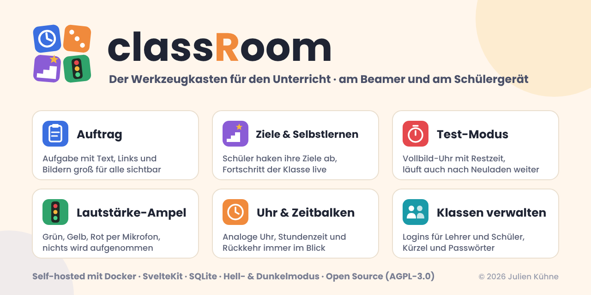

<p align="center"></p>

# classRoom

Ein Werkzeugkasten für Lehrerinnen und Lehrer: verschiedene kleine Tools, die sich direkt während des Unterrichts nutzen lassen – schnell erreichbar, ohne Einarbeitung und gut lesbar am Beamer oder Smartboard. Selbst gehostet per Docker, Daten bleiben auf dem eigenen Server.

## Funktionen

### Kopfzeile

- **Zahnrad-Menü** oben links, zusammen mit dem Logo in einer Leiste – lässt sich ausblenden (erscheint beim Darüberfahren)
- **Zeit-Balken** in der Mitte:
  - *abgelaufene Zeit* seit Beginn der Stunde (mit Sanduhr)
  - *Klassenraum · zurück um HH:MM* – orange kurz vor der Rückkehr, rot wenn die Zeit um ist
- **Große analoge Uhr** mit Wochentag und Datum (dd/mm/yyyy), gut lesbar am Beamer
- **Lautstärke-Ampel** (senkrecht, mit der Uhr in einer Karte) – zeigt über das Mikrofon Grün/Gelb/Rot je nach Lautstärke im Raum
- Auf den Verwaltungsseiten werden Balken, Uhr und Ampel ausgeblendet

### Auftrag (Startseite)

- Box für den aktuellen Auftrag mit Titel, formatiertem Text, Links und Bildern
- Bilder links als kleine Vorschau, mehrere Bilder als kompaktes Raster – Klick zeigt das Bild in voller Größe; Auftragstext rechts daneben
- Editor mit Werkzeugleiste: **fett**, *kursiv*, unterstrichen, Aufzählung, nummerierte Liste, Textfarbe, Link, Bild (auch per Strg+V oder Hineinziehen)
- Kompakter Bearbeitungsmodus: Uhr, Balken und Ampel werden ausgeblendet, damit der Editor ohne Scrollen Platz hat
- Auftrag bearbeiten oder löschen; das HTML wird beim Speichern serverseitig bereinigt
- Button **Stundenziele** direkt unter dem Auftrag

### Stundenziele & Selbstlern-Modus

- Eine Kachel pro Schüler mit Zielen zum Abhaken und Fortschrittsbalken
- Erledigte Ziele werden grün, die Kachel ist ganz grün, wenn alles erledigt ist
- Kompakt für große Klassen (20+ Schüler): Kacheln standardmäßig eingeklappt (nur Name + Fortschritt), einzeln oder für Lehrkräfte per Knopf **alle auf-/einklappen**
- Übersicht über der Klasse, z. B. „12/60 Ziele erledigt · 3 von 20 Schülern fertig“
- Schüler bearbeiten nur ihre eigene Kachel; die Seite aktualisiert sich alle 5 Sekunden
- **Stundenziele** und **Selbstlern-Ziele** sind getrennt; „Neue Stunde“ leert nur die Stundenziele

### Test-Modus

- Anzeige für Prüfungen ohne Kopfzeile und Menü, vollbildtauglich
- Große analoge Uhr, Balken **Vergangen** (mit Startzeit) und **Verbleibend** (mit Endzeit)
- Orange kurz vor Schluss, rot und pulsierend wenn die Zeit um ist
- Start per Dauer (15–90 Min oder eigene) oder Endzeit, Verlängern um 5/10 Minuten
- Läuft serverseitig weiter, auch nach Neuladen oder auf einem zweiten Gerät

### Lautstärke-Ampel

- Misst die Lautstärke über das Mikrofon des Lehrer-Geräts – **nur im Browser**, es wird kein Ton aufgenommen, gespeichert oder übertragen
- Im Menü unter **Ampel-Einstellungen**: Empfindlichkeit, Schwelle für Gelb und Rot, Live-Test mit Pegelanzeige
- Gelb/Rot werden kurz gehalten, damit die Ampel nicht flackert
- **Schüler sehen die Ampel ebenfalls**, solange sie auf dem Lehrer-Gerät läuft – übertragen wird nur die Farbe (grün/gelb/rot), kein Ton
- Hinweis: Browser erlauben das Mikrofon nur über **HTTPS oder `localhost`**

### Verwaltung

- **Schüler verwalten** – Vorname, Nachname und Kürzel; das Kürzel wird vorgeschlagen (3 Buchstaben Vorname + 2 Nachname, z. B. Anna Muster → `annmu`) und passt sich beim Umbenennen an
  - Bearbeiten (✎), neues Passwort (🔑) und Löschen (✕) per Symbol
  - Zugangsdaten mit Kopier-Knöpfen, Ziel-Übersicht je Schüler (Stunde / Selbst)
- **Lehrer verwalten** – weitere Lehrkräfte anlegen, Passwörter setzen

### Allgemein

- **Login** mit zwei Rollen:
  - *Lehrkräfte* sehen alles inkl. Menü
  - *Schüler* sehen Auftrag, Stundenziele und Selbstlern-Modus (ohne Menü)
- **Hell- und Dunkelmodus**, pro Gerät umschaltbar
- Menüpunkte mit Symbolen, die auch auf den jeweiligen Seiten erscheinen

### Zugänge

- Das erste Lehrerkonto kommt aus der `.env` (`TEACHER_USERNAME` / `TEACHER_PASSWORD`). Bei jedem Start wird sein Passwort auf den `.env`-Wert gesetzt – so kommt man nach einem vergessenen Passwort wieder hinein.
- Schüler melden sich mit ihrem **Kürzel** oder mit **„Vorname Nachname“** an.
- Das Passwort eines Schülers wird **nur einmal** angezeigt; „Neues Passwort“ erzeugt ein neues und meldet den Schüler überall ab.
- Nach 5 falschen Passwörtern ist ein Benutzername für 5 Minuten gesperrt.

### Geplant

- Zufallsauswahl, Gruppen bilden

## Technik

SvelteKit (Svelte 5) · SQLite (`better-sqlite3`) · Docker Compose

## Konfiguration

Alle Einstellungen kommen aus einer `.env`-Datei:

```bash
cp .env.example .env
```

| Variable | Bedeutung | Standard |
|---|---|---|
| `CLASSROOM_VERSION` | Version des Docker-Images, z. B. `0.2.1` | `latest` |
| `PORT` | Port der App | `3000` |
| `DATABASE_PATH` | Pfad der SQLite-Datei (nur lokal; im Container fest `/app/data`) | `data/classroom.db` |
| `TEACHER_USERNAME` | Benutzername des Lehrerkontos aus der `.env` | `lehrer` |
| `TEACHER_PASSWORD` | Passwort dazu (mind. 8 Zeichen) – **unbedingt setzen** | leer |
| `SESSION_HOURS` | Wie lange eine Anmeldung gültig bleibt | `12` |
| `DEFAULT_ROOM_NAME` | Name des Klassenraums | `Klassenzimmer` |
| `DEFAULT_START_TIME` | Beginn der Stunde (`HH:MM`) | leer |
| `DEFAULT_RETURN_TIME` | Rückkehr ins Hauptschulzimmer (`HH:MM`) | leer |
| `WARN_MINUTES` | Ab wie vielen Minuten vor der Rückkehr (bzw. vor Testende) der Balken orange wird | `5` |
| `DEFAULT_THEME` | Standard-Darstellung: `system`, `light` oder `dark` | `system` |
| `GOALS_COLLAPSED` | Ziel-Kacheln standardmäßig eingeklappt (nur Name + Fortschritt) | `true` |
| `UPLOAD_MAX_MB` | Maximale Bildgröße im Auftrag (PNG, JPEG, GIF, WebP) | `5` |
| `NOISE_ENABLED` | Lautstärke-Ampel anzeigen (nur Lehrkräfte) | `true` |
| `NOISE_SENSITIVITY` | Empfindlichkeit des Mikrofons, 1–10 | `5` |
| `NOISE_YELLOW` / `NOISE_RED` | Pegel 0–100, ab dem die Ampel gelb bzw. rot wird | `50` / `75` |

Raumname, Beginn, Rückkehrzeit und die Ampel-Einstellungen lassen sich im Menü ändern; diese Werte werden in der Datenbank gespeichert und überschreiben die `.env`-Standardwerte. „Zeiten zurücksetzen“ leert Beginn und Rückkehrzeit.

## Starten

### Installation mit Docker-Image

Fertige Images (amd64 und arm64) gibt es unter `ghcr.io/seals187/classroom`. Auf dem Server reicht ein Ordner mit der [`docker-compose.yml`](docker-compose.yml) aus diesem Repo und einer `.env` (Vorlage: [`.env.example`](.env.example)) – kein Quellcode nötig:

```bash
mkdir -p /opt/classRoom && cd /opt/classRoom
# docker-compose.yml und .env.example aus dem Repo hierher kopieren
cp .env.example .env   # TEACHER_PASSWORD setzen, optional CLASSROOM_VERSION=0.2.1
docker compose pull && docker compose up -d
```

Ohne `CLASSROOM_VERSION` wird `latest` geladen. Update: `CLASSROOM_VERSION` anpassen (oder bei `latest` lassen), dann `docker compose pull && docker compose up -d`.

> Solange das Repository privat ist, ist auch das Image privat. Vorher einmalig anmelden, mit einem GitHub-Token mit dem Recht `read:packages`:
> `echo <TOKEN> | docker login ghcr.io -u seals187 --password-stdin`

### Aus dem Quellcode bauen

Das Image lokal unter demselben Namen bauen; `docker compose up` nimmt dann dieses statt des heruntergeladenen:

```bash
docker build -t ghcr.io/seals187/classroom:latest .
docker compose up -d
```

Danach läuft die App unter <http://localhost:3000> (bzw. dem `PORT` aus der `.env`). Die Datenbank liegt im Docker-Volume `classroom-data` und bleibt bei Updates erhalten.

Backup der Datenbank:

```bash
docker compose cp classroom:/app/data/classroom.db ./backup.db
```

### Lokal mit Node.js (ab Version 22)

```bash
npm ci
npm run dev      # Entwicklung mit Hot-Reload
npm run build && npm start   # Produktionsbuild
```

## Releases & Updates

- **Release erstellen:** Version in `package.json` anheben, committen und einen Tag pushen, z. B. `git tag v0.2.1 && git push origin v0.2.1`. GitHub Actions baut dann das Docker-Image, veröffentlicht es unter `ghcr.io/seals187/classroom` und legt das GitHub-Release an.
- **Abhängigkeiten:** Dependabot prüft wöchentlich npm-Pakete, das Docker-Basis-Image und die GitHub Actions und öffnet bei Updates Pull Requests.
