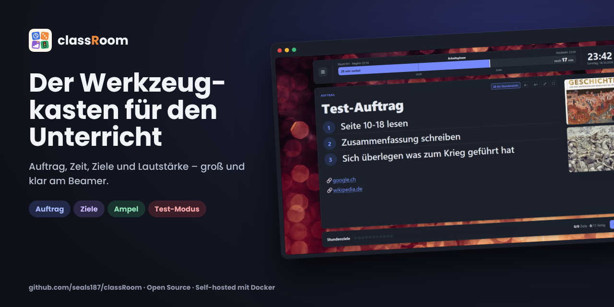
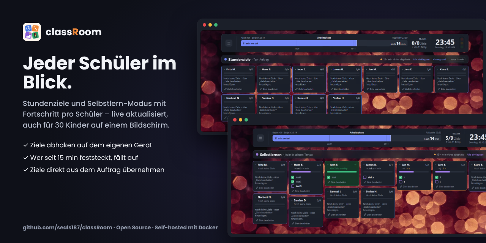
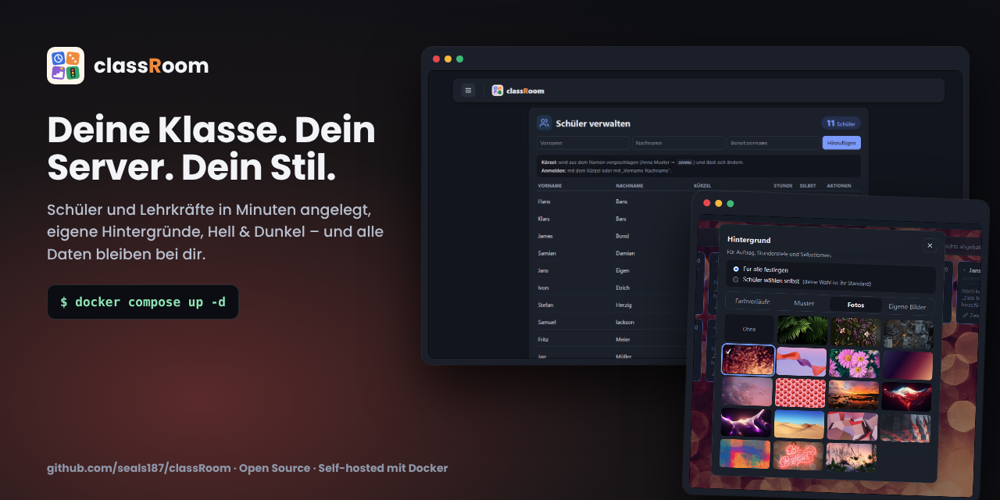

<p align="center"></p>

<p align="center">
  <a href="CHANGELOG.md"></a>
  <a href="LICENSE"></a>
  
  
</p>

**classRoom** ist ein Werkzeugkasten für Lehrerinnen und Lehrer: Auftrag, Zeit, Ziele und Lautstärke – groß und klar am Beamer, ohne Einarbeitung. Selbst gehostet mit Docker, alle Daten bleiben auf dem eigenen Server.

[Funktionen](#funktionen) · [Installation](#installation) · [Konfiguration](#konfiguration) · [Update & Backup](#update--backup) · [Entwicklung](#entwicklung) · [Changelog](CHANGELOG.md)

## Funktionen

| | |
|---|---|
| 📋 **Auftrag** | Großer Titel, nummerierte Schritte, Bilder und Links; Editor mit Formatierung. Schrift per **A− / A+** vergrößern, Vollbild, Schritte mit einem Klick **als Stundenziele** für alle übernehmen. |
| ⏱️ **Kopfband** | Zeitbalken in drei Phasen (Arbeiten · bald zurück · Zeit um) mit Viertelstunden-Strichen, Digitaluhr und **„▶ Jetzt starten · 45 min“**. |
| 🎯 **Stundenziele & Selbstlernen** | Eine Kachel pro Schüler, live aktualisiert, 20–30 Schüler ohne Scrollen. Wer seit 15 min nichts abgehakt hat, wird orange. Schüler können **„Nur meine Kachel“** einschalten. |
| 🚦 **Lautstärke-Ampel** | Misst über das Mikrofon des Lehrer-Geräts – nur im Browser, kein Ton wird gespeichert oder übertragen. Schüler sehen die Farbe. |
| 📝 **Test-Modus** | Große Uhr, vergangene und verbleibende Zeit im Vollbild; läuft serverseitig weiter. |
| 🎨 **Hintergründe** | 25 Verläufe, 26 Muster, 18 Fotos oder eigene Bilder – für alle festgelegt oder von jedem Schüler selbst gewählt. Hell- und Dunkelmodus. |
| 👥 **Verwaltung** | Schüler und Lehrkräfte in Minuten angelegt; Schüler melden sich mit Kürzel oder „Vorname Nachname“ an. |

<p align="center"></p>

<details>
<summary><b>Alle Details zu den Funktionen</b></summary>

**Auftrag (Startseite)**
- Eine nummerierte Liste erscheint als Schritte mit Zahl im Kreis; **Umschalt+Enter** gibt einem Schritt eine graue Zusatzzeile.
- Bilder per Knopf, Strg+V oder Hineinziehen – sie werden vor dem Hochladen verkleinert (höchstens 1920 px, einige hundert KB). Rechts als gleich zugeschnittene Vorschau, ein Klick zeigt das ganze Bild.
- Links stehen klein unten in der Karte. Das HTML wird beim Speichern serverseitig bereinigt.
- Leiste **Stundenziele** darunter: ein Quadrat pro Schüler, je mehr erledigt, desto grüner – sind alle fertig: „🎉 Alle Ziele erledigt“.

**Stundenziele & Selbstlern-Modus**
- Klick auf eine Kachel klappt die Checkliste auf; nur die Kacheln darunter rücken nach. Lehrkräfte können alle auf-/einklappen.
- Selbstlernen zeigt das aktuelle Ziel und die Zeit seit dem letzten Abhaken.
- „Neue Stunde“ leert nur die Stundenziele; Selbstlern-Ziele bleiben.
- Schüler bearbeiten nur ihre eigene Kachel.

**Lautstärke-Ampel**
- Im Menü unter *Ampel-Einstellungen*: Empfindlichkeit, Schwellen für Gelb und Rot, Live-Test.
- Browser erlauben das Mikrofon nur über **HTTPS oder `localhost`**.

**Zugänge**
- Das erste Lehrerkonto kommt aus der `.env`; sein Passwort wird bei jedem Start auf den `.env`-Wert gesetzt – so kommt man nach einem vergessenen Passwort wieder hinein.
- Schüler-Passwörter werden **nur einmal** angezeigt; „Neues Passwort“ meldet den Schüler überall ab.
- Nach 5 falschen Passwörtern ist ein Benutzername 5 Minuten gesperrt.

**Allgemein**
- Für Smartphone und Tablet angepasst; eigene Dialoge im Stil der App.
- Geplant: Zufallsauswahl, Gruppen bilden.

</details>

<p align="center"> </p>

## Installation

Du brauchst nur **Docker mit Compose** – kein Node.js, kein Quellcode. Images gibt es für amd64 und arm64 (z. B. Raspberry Pi).

**1. Ordner anlegen** und zwei Dateien aus diesem Repo hineinkopieren: [`docker-compose.yml`](docker-compose.yml) und [`.env.example`](.env.example).

```bash
mkdir -p /opt/classroom && cd /opt/classroom
# docker-compose.yml und .env.example hierher kopieren
cp .env.example .env
```

**2. Passwort setzen** – in der `.env` mindestens das Lehrerkonto eintragen:

```ini
TEACHER_USERNAME=lehrer
TEACHER_PASSWORD=ein-sicheres-passwort
```

**3. Starten:**

```bash
docker compose pull
docker compose up -d
```

Fertig – classRoom läuft unter **http://localhost:3000** (bzw. `http://<server-ip>:3000`). Mit dem Lehrerkonto anmelden und unter *Menü → Schüler verwalten* die Klasse anlegen.

> [!TIP]
> Für die Lautstärke-Ampel braucht der Browser **HTTPS** (oder `localhost`). Im Schulnetz am einfachsten hinter einen Reverse Proxy wie Caddy oder Traefik stellen.

## Konfiguration

Alles steht in der `.env`; nach einer Änderung `docker compose up -d` ausführen. Raumname, Zeiten, Ampel und Hintergrund lassen sich zusätzlich im Menü ändern – diese Werte überschreiben die `.env`.

| Variable | Wofür | Standard |
|---|---|---|
| `TEACHER_USERNAME` | Benutzername des ersten Lehrerkontos | `lehrer` |
| `TEACHER_PASSWORD` | Passwort dazu – **muss gesetzt werden** (mind. 8 Zeichen) | – |
| `PORT` | Port, unter dem classRoom erreichbar ist | `3000` |
| `CLASSROOM_VERSION` | Image-Version, z. B. `0.3.0` | `latest` |

<details>
<summary><b>Weitere Einstellungen</b></summary>

| Variable | Wofür | Standard |
|---|---|---|
| `SESSION_HOURS` | Wie lange eine Anmeldung gültig bleibt (Stunden) | `12` |
| `DEFAULT_ROOM_NAME` | Name des Klassenraums | `Klassenzimmer` |
| `DEFAULT_START_TIME` / `DEFAULT_RETURN_TIME` | Beginn und Rückkehr (`HH:MM`), leer = nicht gesetzt | – |
| `LESSON_DURATIONS` | Minuten für die Knöpfe „Jetzt starten“, der erste ist der große | `45,90` |
| `WARN_MINUTES` | Ab wie vielen Minuten vor Schluss der Balken orange wird | `5` |
| `DEFAULT_THEME` | `system`, `light` oder `dark` | `system` |
| `GOALS_COLLAPSED` | Ziel-Kacheln anfangs eingeklappt | `true` |
| `UPLOAD_MAX_MB` | Maximale Bildgröße nach dem Verkleinern | `5` |
| `NOISE_ENABLED` | Lautstärke-Ampel anzeigen | `true` |
| `NOISE_SENSITIVITY` | Empfindlichkeit des Mikrofons, 1–10 | `5` |
| `NOISE_YELLOW` / `NOISE_RED` | Pegel 0–100 für Gelb bzw. Rot | `50` / `75` |
| `DATABASE_PATH` | Nur ohne Docker: Pfad der SQLite-Datei | `data/classroom.db` |

</details>

## Update & Backup

```bash
docker compose pull && docker compose up -d                     # aktualisieren (latest bzw. CLASSROOM_VERSION)
docker compose cp classroom:/app/data/classroom.db ./backup.db   # Datenbank sichern
```

Die Datenbank liegt im Docker-Volume `classroom-data` und bleibt bei Updates erhalten; neue Spalten werden beim Start automatisch ergänzt. Was sich geändert hat, steht im [CHANGELOG](CHANGELOG.md).

## Entwicklung

<details>
<summary><b>Aus dem Quellcode bauen, lokal entwickeln, Release erstellen</b></summary>

**Technik:** SvelteKit (Svelte 5) · SQLite (`better-sqlite3`) · Docker

```bash
# Image lokal bauen – docker compose nimmt dann dieses statt des heruntergeladenen
docker build -t ghcr.io/seals187/classroom:latest .
docker compose up -d

# Ohne Docker (Node.js ab 22)
npm ci
npm run dev                  # Entwicklung mit Hot-Reload
npm run build && npm start   # Produktionsbuild
```

**Release:** Version in `package.json` anheben, Abschnitt in `CHANGELOG.md` ergänzen, committen und einen Tag pushen (`git tag v0.3.0 && git push origin v0.3.0`). GitHub Actions baut dann das Image für amd64/arm64, veröffentlicht es unter `ghcr.io/seals187/classroom` und legt das GitHub-Release mit dem Text aus dem CHANGELOG an. Dependabot hält npm-Pakete, Docker-Basis-Image und Actions aktuell.

</details>

## Lizenz & Bildnachweise

classRoom steht unter der [GNU AGPL-3.0](LICENSE) · © 2026 Julien Kühne · [Fehler melden](https://github.com/seals187/classRoom/issues)

Die Fotos unter *Hintergrund → Fotos* stammen von [Pexels](https://www.pexels.com) ([Pexels-Lizenz](https://www.pexels.com/license/)): Dominykas (Farn), Evie Shaffer (Blüten auf Dunkel), Peter Olexa (Stadt am Abend), shotbyrain (Lichter warm), Steve (Band lila, Faltwerk rosa, Würfel, Farbflecken), Alexas Fotos (Margeriten), Codioful (Abendverlauf), David Si (Abendhimmel), DS stories (Herzen), Ian Panelo (Sonnenuntergang), Marcin Jozwiak (Glut rot, Glut lila), Pixabay (Wüste), Timothy Paule II (Be Brilliant), Vlah (Gräser im Abendlicht). Muster und Farbverläufe sind selbst gezeichnet.
